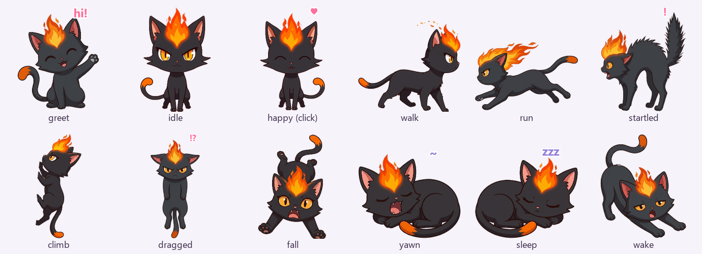

# Desktop Mate: Animated AI Desktop Companion

A desktop pet that lives on your screen: it wanders the taskbar, climbs the screen edges, naps when it's tired, reacts to your cursor, and runs small tasks you type to it.

**Status: the behavior engine, desktop window, three avatar types (paper-doll parts, Live2D, vector placeholder), the fire-cat character, the command box and Windows packaging are implemented and working.**

The companion is a transparent, click-through window that *is* the character. It moves around the desktop by moving the window, so the rest of the screen is untouched. The design separates deciding from drawing:

- **The brain** is a pure-JavaScript state machine with no Electron imports. It owns physics, needs and cursor reactions, and is unit-tested on its own.
- **The renderer** turns the brain's current animation name into a pose for whichever avatar is loaded.
- **The task layer** is a small tool registry. It uses the same shape as LLM function calling, so a language model can be dropped in later without touching the tools.

The bundled character, a black cat with a flame on its head, was made entirely from free AI-generated images. Each image was cut into layers, and the joints are animated in code, so no frames were hand-drawn and no rigging software was used.

Stack: Electron · PixiJS 6 · pixi-live2d-display (Cubism 4) · Node.js · `node:test` · electron-builder · GitHub Actions

Author: Anish Kuila



## Table of contents
- [What it does](#what-it-does)
- [Architecture](#architecture)
- [Scale](#scale)
- [Install](#install)
- [Quickstart](#quickstart)
- [Making your own character](#making-your-own-character)
- [Project structure](#project-structure)
- [Command reference](#command-reference)
- [Limitations](#limitations)

## What it does

```
          ┌──────────── cursor position, drag events, typed commands ────────────┐
          ▼                                                                      │
 [Main process, 60 Hz tick] ──▶ [Brain: events → cursor reactions → state update → bounds]
  (src/main/main.js)              (src/core/brain.js + states.js, pure JS)
          │                                   │
          │                                   ▼  snapshot {state, anim, facing, x, y}
          │                         window.setBounds(x, y)  ←  the window *is* the character
          ▼
 [Renderer] ──▶ DM.pose(anim) ──▶ [Avatar: parts | Live2D | placeholder] ──▶ hit test ──▶ click-through on/off
  (src/renderer/)  (bob, lean, limbs,     (picks a pose drawing per animation,
                    eyes, mouth, emote)    swings limbs, sways tail, flickers flame)

 Typed command ──▶ [Task registry: parse(text) → run(args, ctx)] ──▶ speech bubble / behavior / browser
                    (src/main/tasks.js)
```

**On launch** the cat drops in from the top of the screen, lands, and waves hello. From then on it lives on its own:

- **Autonomous behavior:** it walks along the taskbar, sits, heads to a screen edge and climbs it, then hangs there for a while. It either climbs back down head first or lets go and falls.
- **Getting tired:** an energy need drains while it's awake. As energy drops it yawns more often and eventually curls up to sleep. Going to sleep always plays the open-mouth yawn first, then the closed-eye sleep. When it's rested, or when you click it, it wakes with a long stretch.

**It reacts to your cursor:**

| Interaction | What happens |
|---|---|
| Fast cursor swipe nearby | Startled (arched back, hissing), then often runs away. On a wall, it falls off. |
| Cursor resting nearby | Walks over to it, curious |
| Rub the cursor over its head | Happy: ^ ^ eyes, a smile and a heart |
| Click | Happy, or wakes up if asleep |
| Drag and release | Dangles from the scruff, swinging as you move it, then is thrown with your mouse's speed |
| Double-click or **Ctrl+Alt+M** | Opens the command box |
| Right-click | Menu: talk, actions (walk, sit, yawn, sleep, climb, cheer), toggle wandering, quit |

**Each animation uses its own drawing** (see the image above). All drawings are generated images of the same character:

- **Walking:** a side view whose four legs swing in a diagonal gait.
- **Running:** a gallop.
- **Climbing:** front paws and back legs alternate as it climbs.
- **Other poses:** startled, dangling, falling, landing, waving, yawning, sleeping and stretching each have their own drawing.
- **Turning:** a three-quarter view flashes for a moment when it starts or stops walking, so it doesn't snap from facing you to side-on.

Every drawing also gets procedural motion so it never looks frozen:

| Part | Motion |
|---|---|
| Tail | sways: wags when happy, flails when falling, barely moves when asleep |
| Flame | flickers, calms while sleeping, flares when startled |
| Whole body | bounces, sways, breathes, or trembles depending on the pose |
| Dangling drawing | swings from the top like a pendulum, following how fast you drag it |

**The command box** understands a small set of tasks: timers (`timer 5 min tea`), the time, web searches, opening links, and behaviors (`sleep`, `walk`, `climb`, `dance`). Replies appear in a speech bubble above the cat. Each tool has a `parse` step and a `run` step, and side effects only happen through a context object (`say`, `behave`, `openExternal`, `setTimer`). That keeps the tools testable and is the hook for routing free-form text through an LLM later.

## Architecture

| Layer | Technology | Status |
|---|---|---|
| Desktop window | Electron: one transparent, frameless, always-on-top (`screen-saver` level) window, 300 × 400, hidden from the taskbar. It moves with `setBounds` every tick, and the size is passed each time so Windows DPI scaling can't drift it. | Implemented |
| Click-through | `setIgnoreMouseEvents(true, { forward: true })`, toggled by a per-frame hit test against the cursor position sent with each tick. It works while the window slides under a still cursor. | Implemented |
| File serving | A privileged `app://` protocol serves the project root (with a path-traversal guard), so Live2D's loaders work with web security on | Implemented |
| Behavior engine | Pure JS state machine: 19 states, each with `anim`, `surface` (floor / wall / air), `interruptible`, `enter` and `update` | Implemented |
| Physics | Gravity, air drag, wall bounce, throws from the mouse's speed, falling when a floor or wall disappears (taskbar moved, display unplugged) | Implemented |
| Needs | Energy drains while awake and refills while asleep, which biases the next choice toward yawning and sleeping | Implemented |
| Cursor reactions | Startle on a fast swipe, petting on the head, curiosity and approach to a resting cursor, waking on a jiggle | Implemented |
| Procedural poses | `pose.js` produces bob, squash, lean, sit, head tilt, limb angles, eyes, mood, mouth and emote for every animation name; all avatars read it | Implemented |
| Parts avatar | Full-canvas PNG layers, auto-trimmed at load, on joint pivots. Supports per-animation pose drawings, four-legged gaits, tail sway, flame flicker, sprite or code-drawn faces, an open-mouth frame swap, transition poses, and soft joint stubs so swinging limbs never show a cut. | Implemented |
| Live2D avatar | pixi-live2d-display with Cubism 4: motion groups mapped per animation, eye and mouth parameters driven from the pose, cursor focus | Implemented (needs a model and the Cubism core; see Limitations) |
| Placeholder avatar | A vector chibi used whenever the configured avatar fails to load | Implemented |
| Task layer | Tool registry `{ name, description, parse, run }` with the same shape as LLM function calling | Implemented (regex parsing) |
| Tests | `node --test`: the brain run with a seeded RNG (20 simulated minutes, drag, throw, click, swipe, petting, sleep and wake, climb down, greeting) plus the task parser | Implemented |
| CI/CD | GitHub Actions: syntax check and tests on Ubuntu and Windows for every push and PR. A `v*` tag builds the Windows installer and portable exe and attaches them to a GitHub release. | Implemented |
| Packaging | electron-builder: NSIS installer and portable exe. Source art (`source*.jpg`) is excluded from the build. | Implemented |

## Scale

Counted directly from the codebase, not estimated:

| Metric | Count |
|---|---|
| Behavior states | 19 |
| Animation names | 17 |
| Avatar types | 3 (parts, Live2D, placeholder) |
| AI-generated source images for the fire cat | 15 |
| Pose drawings (per-animation rigs) | 12, plus 1 transition pose |
| PNG layers in the fire cat | 48 |
| Cursor reactions | 4, plus click and drag/throw |
| Task tools | 6 (`help`, `set_timer`, `get_time`, `open_url`, `web_search`, `behave`) |
| IPC channels | 10 |
| Automated tests | 15, across 2 files |
| CI workflows | 2 (CI, release) |
| Build targets | 2 (NSIS installer, portable exe) |

## Install

Requires Node 20+ and Windows 10/11. macOS should work, since the window code is cross-platform, but it hasn't been tested.

```bash
git clone https://github.com/anishneu/desktop-mate.git
cd desktop-mate
npm install
```

## Quickstart

```bash
npm start
```

The fire cat drops onto your taskbar and waves. Right-click it for the menu, or press **Ctrl+Alt+M** to type a command.

Run the tests:

```bash
npm test
```

Check a pose without waiting for it to happen. This launches the app, takes a picture of the window, saves it as `snapshot.png` and quits:

```bash
npm run snapshot -- --state=sleep
```

- `--state=` forces a behavior state once the cat has landed.
- `--delay=300` (milliseconds after forcing) catches short states like `land`.
- `--anim=climb` shows an animation's drawing whatever the state, which is useful for wall and air poses.

Build the Windows installer and portable exe into `dist/`:

```bash
npm run dist
```

To publish a release, push a tag like `v0.2.0`. The release workflow builds both executables and attaches them to a GitHub release.

**Using a Live2D model instead:**
1. Download the Cubism SDK for Web from live2d.com.
2. Copy `Core/live2dcubismcore.min.js` to `assets/vendor/`.
3. Copy a model, for example `Samples/Resources/Hiyori/`, to `assets/models/Hiyori/`.
4. Set `"avatar": "live2d"` in `assets/character.json`.

## Making your own character

No drawing skills or subscriptions are needed:

1. Generate one front-facing image with a free image generator.
2. Cut it into a few layers in Photopea, GIMP or Krita.
3. Write a `parts.json` with the joint positions.
4. For better animation, generate more drawings of the same character, one per pose (walking, sleeping, climbing and so on), and list them under `poses`.

[docs/PARTS.md](docs/PARTS.md) has the full workflow: example prompts, how to cut layers, the `parts.json` format, face modes, pose drawings, four-legged gaits, tails, flames and open-mouth frames. `assets/parts/template/` is a minimal example and `assets/parts/fire-cat/` is the full one.

## Project structure

```
desktop-mate/
├── package.json                 Scripts (start, snapshot, test, dist) + electron-builder config
├── .github/workflows/
│   ├── ci.yml                    Syntax check + tests on Ubuntu and Windows
│   └── release.yml               v* tag → Windows installer + portable exe on a GitHub release
├── assets/
│   ├── character.json            Which avatar to load, window and hitbox size, tuning, Live2D motion map
│   ├── parts/
│   │   ├── template/             The vector chibi exported as parts, with GUIDE.png (joint diagram)
│   │   └── fire-cat/             The fire cat: parts.json, 48 PNG layers, source_*.jpg (not packaged)
│   ├── models/                   Live2D models (git-ignored; see its README)
│   └── vendor/                   Live2D Cubism core (git-ignored; not redistributable)
├── src/
│   ├── core/                     Behavior engine, no Electron imports
│   │   ├── brain.js              Physics, needs, events, cursor reactions, autonomous choice
│   │   └── states.js             The state table
│   ├── main/
│   │   ├── main.js               Window, 60 Hz tick, app:// protocol, IPC, menu, shortcut, snapshot tool
│   │   └── tasks.js              Tool registry for typed commands
│   ├── preload/
│   │   └── preload.js            The IPC bridge exposed to the page as window.mate
│   └── renderer/
│       ├── index.html            Page + CSP
│       ├── renderer.js           Pixi stage, avatar loading with fallback, click-through, drag, bubble, prompt
│       ├── style.css
│       ├── avatar/
│       │   ├── pose.js           Procedural pose for every animation name
│       │   ├── parts-avatar.js   Paper-doll rig: pose drawings, gaits, tail, flame, faces, mouth frames
│       │   ├── live2d-avatar.js  Live2D model driver
│       │   ├── placeholder-avatar.js  Vector chibi fallback
│       │   ├── face.js           Code-drawn anime eyes and mouth, blinking, gaze
│       │   └── fx.js             Emotes above the head (♥, zzz, !, hi!)
│       └── dev/
│           └── export-template.js  `npm run export-template`: writes the parts template
├── test/
│   ├── brain.test.js             Behavior engine (seeded RNG)
│   └── tasks.test.js             Command parsing
├── docs/
│   ├── ARCHITECTURE.md           Stack choices, asset pipeline, state machine diagram, roadmap
│   ├── PARTS.md                  Making a parts avatar from AI art
│   └── screenshots/
└── LICENSE
```

## Command reference

Type these into the command box (double-click the cat or press **Ctrl+Alt+M**):

| Command | What it does |
|---|---|
| `help` | Lists what it understands |
| `time` | Says the current time |
| `timer 5 min tea` | Sets a timer of up to 24 hours. The cat tells you when it's done. |
| `search cute cats` | Opens a DuckDuckGo search in your browser |
| `open https://…` | Opens an http/https link in your browser |
| `sleep` / `nap` | Yawns, then sleeps |
| `walk` / `wander` | Walks somewhere |
| `sit` | Sits down |
| `climb` | Heads to a screen edge (usually the nearer one) and climbs it |
| `dance` / `jump` | Cheers |

## Limitations

- **Instant switches:** pose drawings replace each other without in-between frames. The turn pose softens this only when walking starts or stops. Each pose is one drawing whose limbs, tail and body move; nothing changes shape the way a frame-by-frame animation would.
- **Fixed faces:** only the front-facing drawing blinks and changes expression. The other drawings keep the face they were drawn with, except the yawn, which swaps to an open-mouth version of the sleeping drawing.
- **Hand-matched sizes:** AI-generated poses vary a little in proportions. Each pose's on-screen size was matched by eye, and the hitbox the brain uses for edges and the head is one fixed size, so a wide pose like walking can poke slightly past a screen edge.
- **Screen edges only:** the cat walks the taskbar and climbs the screen edges, not the tops of other windows. That needs Win32 window enumeration and is on the [roadmap](docs/ARCHITECTURE.md).
- **No language model yet:** commands are matched by regular expressions, so phrasing outside those patterns isn't understood. The tool registry is already shaped for LLM function calling, but no model is wired in.
- **Live2D needs your own files:** the Live2D path hasn't been tested with a real model in this repository. The Cubism core and sample models can't be redistributed, so they have to be downloaded separately.
- **Windows-focused:** it's built and tested on Windows 11. macOS and Linux are untested.
- **No settings UI:** there's no settings window, tray icon or start-with-Windows option yet. Settings live in `assets/character.json`.
- **Partial test coverage:** the tests cover the behavior engine and the command parser, not the renderer. Rendering is checked with the snapshot tool.

## License

MIT — see [LICENSE](LICENSE).
